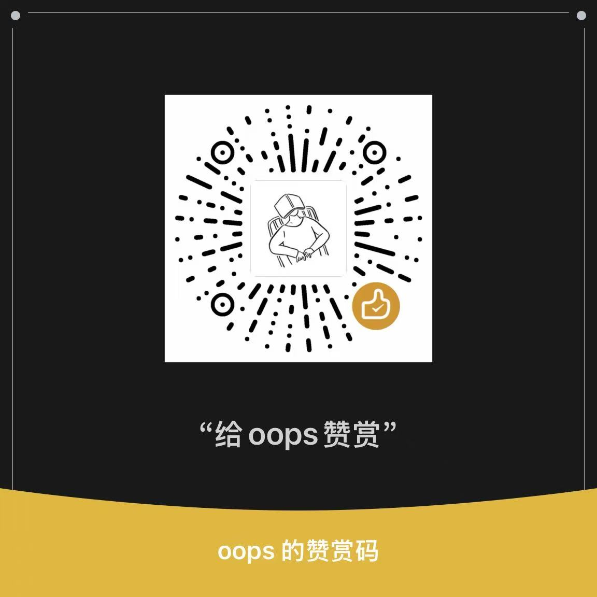

# 500px Auto Tag

Chrome 浏览器扩展，为 500px CreatorStudio 自动生成 VCG（视觉中国）风格的图片标题和关键词，并**自动识别拍摄地点**填入级联选择器。

## 支持的 AI 服务

| 服务 | 模型 | 速度 | 效果 | 成本 |
|------|------|------|------|------|
| **火山引擎 Coding Plan** | doubao-seed-2.1-pro / lite | 4-8秒/张（并行） | 优 | 包月订阅 |
| **Ollama 本地** | Qwen3-VL 4B/8B | 30-60秒 | 中 | 免费 |

推荐使用**火山引擎 Coding Plan**，中文理解能力强，支持图片理解，包月不限调用。

## 功能

### AI 标题与关键词
- **VCG 风格标题**：15~30 字长标题，含主体、场景、光线、氛围
- **关键词自动生成**：默认 35 个，具体事物型关键词（自动禁用"风景/自然/旅行"等泛词）
- **中 / 英文**双语输出
- **质量评分**：AI 自评质量，低质量自动重新分析

### AI 地点识别（v1.0.3+）
- **自动识别拍摄地**：AI 从图片推断拍摄地点，填入"国家/省/市"级联选择器
- **行政区划精确匹配**：只在 500px 真实列表中查找，**唯一匹配才填入**——匹配不到就留空并提示，绝不瞎点（景区名、县级市会被规范化到所属地级州，如"茶卡盐湖"→ 青海省海西州）
- **地点范围提示**：可设置参考范围（如"青甘大环线"），AI 只在青海、甘肃行政区划内选择，跨区域误判直接留空
- **三层保障**：匹配失败→带反馈重新识别→仍失败用上一张成功地点兜底

### 批量流水线（v1.0.13+）
- **流式并行**：滚动窗口提取图片 + AI 最高 16 路并发 + 串行填表，三者流水线作业，无需预先全量提取
- **实测 1.5 秒/张**：209 张大草稿约 5 分钟跑完
- **可提交状态验证**：每张填完自动检查 `canSubmit`，未达标针对性重试 2 次，仍失败标记跳过不卡流程
- **防选中累积**：每张处理完自动取消选中，突破页面约 115 张的选中上限
- **智能跳过**：已提交（canSubmit）的图片自动跳过，不重复处理

### 其他
- **一键分享全部**：自动逐张点击分享到 500px
- **默认关键词**：每张追加默认关键词（AI 关键词自动缩减以保证总上限）
- **默认地点**：AI 未识别出地点时使用默认地点填充

## 火山引擎 Coding Plan 配置

1. 注册火山引擎账号：https://console.volcengine.com
2. 进入方舟（Ark）平台：https://console.volcengine.com/ark
3. 开通 **Coding Plan** 订阅，并在「开通管理」中激活视觉模型（如 `doubao-seed-2-1-lite`）
4. 获取 API Key：方舟平台 → API Key 管理 → 创建新 Key
5. 在插件设置中选择「火山引擎豆包」，填写 API Key，选择模型（推荐 `doubao-seed-2.1-pro`）

> API Key 仅保存在浏览器本地（chrome.storage），不随代码上传、不上传任何服务器。

## Ollama 本地配置（备选）

```bash
ollama pull qwen3-vl:4b
```

环境变量：`OLLAMA_ORIGINS=*`

## 安装使用

1. 下载本仓库代码
2. Chrome 打开 `chrome://extensions/`
3. 开启右上角「开发者模式」
4. 点「加载已解压的扩展程序」，选择本仓库目录
5. 打开插件设置面板，选择 AI 服务（火山引擎/Ollama），填写配置
6. 打开 [creatorstudio.500px.com.cn](https://creatorstudio.500px.com.cn) 上传页
7. 点击图片缩略图选中，再点左下角 `✨ AI Auto Tag` 按钮处理单张
8. 或点 `⚡ 批量处理全部` 流水线处理所有图片
9. 或点 `📤 一键分享全部` 自动逐张分享到 500px

## 注意事项

- Coding Plan 必须使用专用端点（插件已内置），模型未激活会报 404 "ModelNotOpen"，需到方舟控制台「开通管理」激活模型
- 提示"AI 处理出错"多为当日额度用尽或订阅到期，检查方舟控制台
- Ollama 必须设置 `OLLAMA_ORIGINS=*`，否则扩展请求会被 403 拒绝
- 批量处理可随时点「停止」，已完成部分不受影响
- 地点留空（⚠️ 提示"不在列表中"）说明 AI 无法在限定范围内确定拍摄地，可手动补充

## 赞赏

如果这个工具对你有帮助，欢迎赞赏支持：


